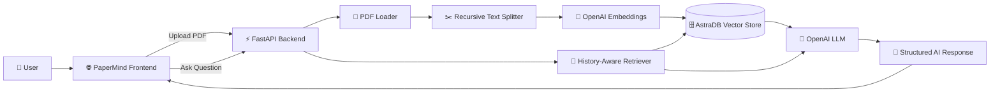

# 🧠 PaperMind — AI Research Assistant

> **Think deeper. Research faster.**

PaperMind is an AI-powered research assistant designed to help researchers, students, and academics **read, understand, analyze, compare, and discuss research papers using natural language**.

Upload one or multiple research papers in PDF format, and PaperMind transforms them into a searchable knowledge base. You can then ask questions, summarize papers, explain methodologies, extract experimental results, identify limitations, and have a continuous conversation with your research documents.

<p align="center">

[🚀 Live Demo](https://papermind-vmio.onrender.com/) •


</p>

---

## ✨ Why PaperMind?

Reading research papers can be time-consuming, especially when you need to quickly understand:

* What problem does the paper solve?
* What methodology was used?
* Which dataset was used?
* What model or algorithm was proposed?
* What were the experimental results?
* What are the limitations?
* How does one paper compare with another?
* What research gaps can be explored?

PaperMind turns this process into an **interactive conversation with your research library**.

Instead of manually searching through dozens of pages, simply ask:

> **"What dataset did the authors use?"**

> **"Explain their methodology in simple terms."**

> **"What are the major limitations of this study?"**

> **"Compare the approaches used in these papers."**

PaperMind retrieves relevant information from your uploaded papers and uses an LLM to generate a structured response.

---

# 🚀 Features

| Feature                        | Description                                                      |
| ------------------------------ | ---------------------------------------------------------------- |
| 📄 **Multiple PDF Upload**     | Upload one or multiple research papers                           |
| 🔍 **Semantic Search**         | Search paper content using vector embeddings                     |
| 💬 **Conversational AI**       | Ask follow-up questions while maintaining context                |
| 📝 **Paper Summarization**     | Generate concise executive summaries                             |
| 🧑‍🏫 **Paper Explanation**    | Understand difficult concepts in simpler language                |
| ⚙️ **Methodology Analysis**    | Extract datasets, preprocessing, models, training and evaluation |
| 📊 **Result Extraction**       | Extract metrics, findings and experimental results               |
| ⚠️ **Limitation Detection**    | Identify limitations, weaknesses and research gaps               |
| 📚 **Multi-Paper Analysis**    | Ask questions across multiple uploaded papers                    |
| 🧠 **History-Aware Retrieval** | Understand follow-up questions using conversation history        |
| 👤 **User-Isolated Knowledge** | Documents are filtered using a unique user ID                    |
| 💭 **AI Thinking Indicator**   | Shows when the research assistant is processing a question       |
| 📱 **Responsive UI**           | Designed for desktop and mobile                                  |
| 🗂️ **Research Library**       | View uploaded papers and library statistics                      |
| 🔄 **New Conversation**        | Clear the current user's indexed research data                   |
| 🧹 **Session Cleanup**         | Automatically clean user data when leaving the page              |

---

# 🖥️ Application Interface

The PaperMind interface provides a complete research workspace containing:

* Research dashboard
* Paper library
* AI research chat
* Research actions
* Upload area
* Recent papers
* Storage statistics
* Question and insight counters

The frontend defines dedicated actions for **Summarize Paper, Explain Paper, Methodology, Extract Results, and Find Limitations**.

---

# 🏗️ System Architecture



---

# 🔄 RAG Pipeline

PaperMind follows a **Retrieval-Augmented Generation (RAG)** architecture.

### 1. Upload

The user uploads one or multiple PDF research papers.

```text
PDF → FastAPI → Temporary File
```

### 2. Document Loading

PDF files are loaded using:

```python
PyPDFLoader
```

### 3. Text Splitting

Documents are divided into smaller chunks using:

```python
RecursiveCharacterTextSplitter(
    chunk_size=1000,
    chunk_overlap=200
)
```

This creates overlapping chunks so that important contextual information is less likely to be lost.

### 4. Metadata Assignment

Every chunk receives a `user_id`:

```python
doc.metadata["user_id"] = user_id
```

This allows PaperMind to isolate each user's research documents.

### 5. Embedding Generation

Each document chunk is converted into a vector representation using:

```text
text-embedding-3-large
```

### 6. Vector Storage

The embeddings are stored in:

```text
AstraDB
```

using the `PaperMind` collection.

### 7. Semantic Retrieval

When a user asks a question, PaperMind retrieves the most relevant document chunks.

The retriever is configured with:

```python
search_kwargs = {
    "k": 10,
    "filter": {
        "user_id": user_id
    }
}
```

### 8. Conversation-Aware Retrieval

Before retrieval, the system uses the previous conversation history to convert follow-up questions into standalone questions.

For example:

```text
User:
What dataset did the paper use?

User:
How large was it?
```

PaperMind can understand that **"it" refers to the dataset mentioned previously**.

### 9. LLM Generation

The retrieved context and conversation history are passed to the LLM.

The assistant is instructed to:

* Ground answers in retrieved research context
* Avoid hallucinating information
* Preserve numerical values
* Distinguish author claims from interpretation
* Avoid mixing information between papers
* Clearly identify unsupported information

### 10. Response

The generated answer is returned to the frontend and displayed inside the research chat.

---

# 🧩 Tech Stack

## Frontend

* HTML5
* CSS3
* JavaScript
* Responsive UI
* Browser `sessionStorage`
* Fetch API
* Drag-and-drop file upload
* `crypto.randomUUID()`

## Backend

* Python
* FastAPI
* Pydantic
* Uvicorn
* CORS Middleware

## Generative AI

* OpenAI Chat Models
* OpenAI Embeddings
* LangChain

## RAG

* LangChain Retrieval
* History-Aware Retriever
* Recursive Character Text Splitter
* PyPDFLoader

## Vector Database

* DataStax Astra DB

## Deployment / Networking

* AWS / Cloud deployment
* Cloudflare Tunnel

---

# 📁 Project Structure

A recommended project structure for PaperMind:

```text
PaperMind/
│
├── frontend/
│   ├── index.html
│   ├── css/
│   │   └── style.css
│   └── js/
│       └── app.js
│
├──── Assistant/
│       ├── assistant.py
|       └── rag.py
|____main.py
│
├── .env
├── .gitignore
├── requirements.txt
└── README.md
```

---

# 🔌 API Endpoints

## `GET /`

Health-check endpoint.

### Response

```json
{
  "message": "AI research Assistant"
}
```

---

## `POST /ask`

Send a research question to PaperMind.

### Request

```json
{
  "input": "Explain the methodology used in this paper.",
  "user_id": "unique-user-id"
}
```

### Response

```json
{
  "response": "The paper uses..."
}
```

---

## `POST /upload`

Upload one or multiple PDF research papers.

### Form Data

```text
files: PDF file(s)
user_id: unique user ID
```

### Response

```json
{
  "message": "Files uploaded and processed successfully",
  "files": [
    "paper1.pdf",
    "paper2.pdf"
  ]
}
```

---

## `DELETE /delete_user_data`

Deletes the user's indexed research documents and starts a new conversation.

```text
DELETE /delete_user_data?user_id=USER_ID
```

---

## `POST /cleanup`

Used when the user leaves the page to clean up the current user's indexed data.

```text
POST /cleanup
```

Form data:

```text
user_id=USER_ID
```

---

# 🤖 AI Capabilities

PaperMind's system prompt is designed specifically for academic research.

### 📄 Summarization

Ask:

```text
Summarize the key contributions of this paper.
```

### ⚙️ Methodology

Ask:

```text
Explain the complete methodology used in this research.
```

### 📊 Experimental Results

Ask:

```text
What were the best-performing models and their results?
```

### ⚠️ Limitations

Ask:

```text
What are the limitations and weaknesses of this study?
```

### 🔬 Research Gaps

Ask:

```text
What research gaps can be identified from these papers?
```

### 🆚 Paper Comparison

Ask:

```text
Compare the methodology and results of these two papers.
```

### 💬 Follow-up Conversation

You can naturally continue the conversation:

```text
User:
What dataset did they use?

AI:
The authors used the XYZ dataset...

User:
How many samples were in it?

AI:
The dataset contains...
```

The conversation history allows PaperMind to understand these contextual follow-up questions.

---

# 🧠 AI Safety & Grounding

PaperMind is designed to reduce hallucination when answering questions about research papers.

The assistant is instructed to:

```text
✓ Use retrieved research context
✓ Never invent statistics
✓ Never invent methodology
✓ Never invent citations
✓ Preserve numerical values
✓ Distinguish author claims from interpretation
✓ Identify which paper information belongs to
✓ State when information cannot be found
```

This makes the system particularly useful for **research-oriented question answering**.

---

# 🔐 User Data Isolation

Each browser session generates a unique user ID:

```javascript
let userId = crypto.randomUUID();
```

The user ID is sent to the backend with questions and uploaded documents.

On the backend, retrieved documents are filtered using:

```python
{
    "user_id": user_id
}
```

Therefore, retrieval is scoped to the current user's indexed documents.

---

# 📦 Installation

## 1. Clone the Repository

```bash
git clone YOUR_GITHUB_REPOSITORY_LINK
cd PaperMind
```

---

## 2. Create a Virtual Environment

```bash
python -m venv venv
```

### macOS / Linux

```bash
source venv/bin/activate
```

### Windows

```bash
venv\Scripts\activate
```

---

## 3. Install Dependencies

```bash
pip install -r requirements.txt
```

---

# 🔑 Environment Variables

Create a `.env` file in the backend/project root:

```env
OPENAI_API_KEY=your_openai_api_key

ASTRA_DB_APPLICATION_TOKEN=your_astra_db_token

ASTRA_DB_API_ENDPOINT=your_astra_db_endpoint
```

⚠️ **Never commit `.env` to GitHub.**

Add this to `.gitignore`:

```gitignore
.env
__pycache__/
*.pyc
venv/
.venv/
.DS_Store
```

---

# ▶️ Running the Backend

Start FastAPI with:

```bash
uvicorn main:app --reload --host 0.0.0.0 --port 8000
```

The API will be available at:

```text
http://127.0.0.1:8000
```

FastAPI documentation:

```text
http://127.0.0.1:8000/docs
```

---

# 🌐 Running the Frontend

Open the frontend:

```text
frontend/index.html
```

or serve it using a local HTTP server:

```bash
python -m http.server 5500
```

Then open:

```text
http://localhost:5500
```

Make sure the API URL inside `app.js` points to your deployed FastAPI backend.

For example:

```javascript
fetch("YOUR_BACKEND_URL/ask")
```

and:

```javascript
fetch("YOUR_BACKEND_URL/upload")
```

---

# ☁️ Deployment

PaperMind can be deployed using a separate frontend and backend architecture:

```text
                    ┌────────────────────┐
                    │   Frontend Hosting │
                    │ HTML/CSS/JS         │
                    └─────────┬──────────┘
                              │
                              ▼
                    ┌────────────────────┐
                    │ FastAPI Backend     │
                    │ AWS / Cloud Server  │
                    └─────────┬──────────┘
                              │
                 ┌────────────┴────────────┐
                 ▼                         ▼
        ┌─────────────────┐       ┌─────────────────┐
        │ OpenAI API      │       │ AstraDB         │
        │ LLM + Embedding │       │ Vector Database │
        └─────────────────┘       └─────────────────┘
```

---

# 🛠️ Example Research Workflow

```text
1. Open PaperMind
        ↓
2. Upload research papers
        ↓
3. Papers are processed
        ↓
4. PDF text is extracted
        ↓
5. Text is split into chunks
        ↓
6. Embeddings are generated
        ↓
7. Vectors are stored in AstraDB
        ↓
8. Ask a research question
        ↓
9. Relevant chunks are retrieved
        ↓
10. Conversation history is considered
        ↓
11. LLM generates grounded answer
        ↓
12. Answer displayed in research workspace
```

---

# 📸 Suggested Screenshots

For the GitHub README, add screenshots such as:

```text
docs/
├── dashboard.png
├── paper-upload.png
├── ai-chat.png
├── methodology-analysis.png
└── paper-comparison.png
```

Then display them:

```markdown
## 📸 Screenshots

### Research Dashboard


### AI Research Assistant


### Paper Upload


```

---

# 📈 Future Improvements

Some useful extensions for PaperMind include:

* [ ] 📚 Citation extraction
* [ ] 🔗 Source/page citations in AI responses
* [ ] 📊 Automatic table and figure extraction
* [ ] 🧮 Equation understanding
* [ ] 🆚 Dedicated paper comparison mode
* [ ] 📑 Literature review generation
* [ ] 🔎 Research-gap discovery
* [ ] 🧠 Long-term research memory
* [ ] 📤 Export AI analysis to PDF
* [ ] 📝 Generate literature review drafts
* [ ] 🔖 Paper tagging and categorization
* [ ] 👥 Multi-user authentication
* [ ] 🗃️ Persistent conversation history
* [ ] 📊 Research analytics dashboard

---

# ⚠️ Current Deployment Note

The frontend currently calls the FastAPI backend through a Cloudflare Tunnel URL.

Before publishing the repository, replace the backend URL in:

```text
frontend/js/app.js
```

with your permanent backend URL.

Also avoid committing temporary Cloudflare Tunnel URLs if they are not intended to remain public.

---

# 🔒 Security Notes

Do **not** expose the following values in frontend code or GitHub:

```text
OPENAI_API_KEY
ASTRA_DB_APPLICATION_TOKEN
ASTRA_DB_API_ENDPOINT
```

Keep all secrets on the backend using environment variables.

The frontend should communicate with FastAPI, while FastAPI communicates with OpenAI and AstraDB.

---

# 🎯 Use Cases

PaperMind can be useful for:

### 🎓 Students

Quickly understand papers for:

* Thesis preparation
* Assignments
* Literature reviews
* Research proposals

### 🔬 Researchers

Analyze:

* Methodologies
* Datasets
* Experimental results
* Research gaps
* Limitations

### 👨‍💻 AI/ML Engineers

Explore:

* Model architectures
* Training approaches
* Evaluation metrics
* Benchmark comparisons

### 📚 Academics

Use PaperMind as an interactive assistant for exploring large collections of research literature.

---

# 🧪 Example Questions

```text
What is the main contribution of this paper?

Explain the methodology step by step.

What dataset was used?

How large is the dataset?

What preprocessing techniques were applied?

What model architecture did the authors propose?

What evaluation metrics were used?

What were the best results?

What are the limitations of this study?

What research gaps can be identified?

Compare the methodologies of these papers.

Which paper achieved better performance?

Explain this paper as if I am a beginner.

Explain the proposed model at a technical level.
```

---

# 🧰 Main Dependencies

The project is built around the following ecosystem:

```text
FastAPI
LangChain
LangChain OpenAI
LangChain Community
PyPDF
OpenAI
AstraDB
Pydantic
python-dotenv
```

A typical `requirements.txt` can contain:

```text
fastapi
uvicorn
python-multipart
python-dotenv
langchain
langchain-openai
langchain-community
langchain-classic
langchain-text-splitters
langchain-astradb
pypdf
```

---

# 👨‍💻 Author

**Nure Alam Siddiki Rachin**

AI / Machine Learning Developer
Research & Generative AI Enthusiast

Interested in:

```text
Artificial Intelligence
Generative AI
Large Language Models
RAG Systems
Machine Learning
Deep Learning
Research Automation
```

---

# ⭐ Support

If you find PaperMind useful, consider giving the repository a ⭐ on GitHub.

Your feedback and contributions are welcome!

---

<p align="center">

### 🧠 PaperMind

**Turn research papers into an intelligent conversation.**

Built with ❤️ using **FastAPI + LangChain + OpenAI + AstraDB**

</p>
